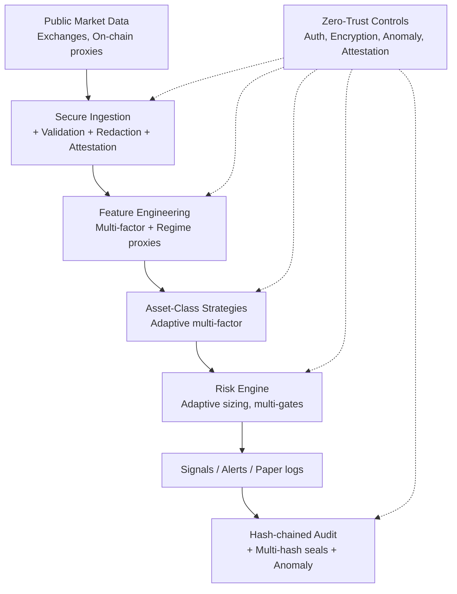

# Architecture (v3)

Modular paper-only information system with enhanced layers:

1. **Secure Ingestion** — public data + synthetic fixtures, schema validation, redaction of potential secrets, source attestation.
2. **Feature Engineering** — multi-factor proxies (EMA, ATR, RSI, volume ratios, funding rates, OI, TVL, relative strength, on-chain activity, regime scores, anomaly metrics).
3. **Asset-Class Strategies** — specialized adaptive multi-factor rules with regime detection and multi-timeframe confluence.
4. **Risk Engine** — class-specific caps, volatility targeting, correlation filters, anomaly/drawdown/kill-switch gates, adaptive position sizing.
5. **Audit & Monitoring** — hash-chained logs with multi-hash seals, continuous verification, anomaly detection on audit stream.

Zero-trust controls overlay every layer.

## Design Choices
- Offline-first with injectable I/O for tests.
- Synthetic fixtures generated reproducibly.
- Strategy outputs are signals only, never orders.
- Security gates run in CI and locally.
